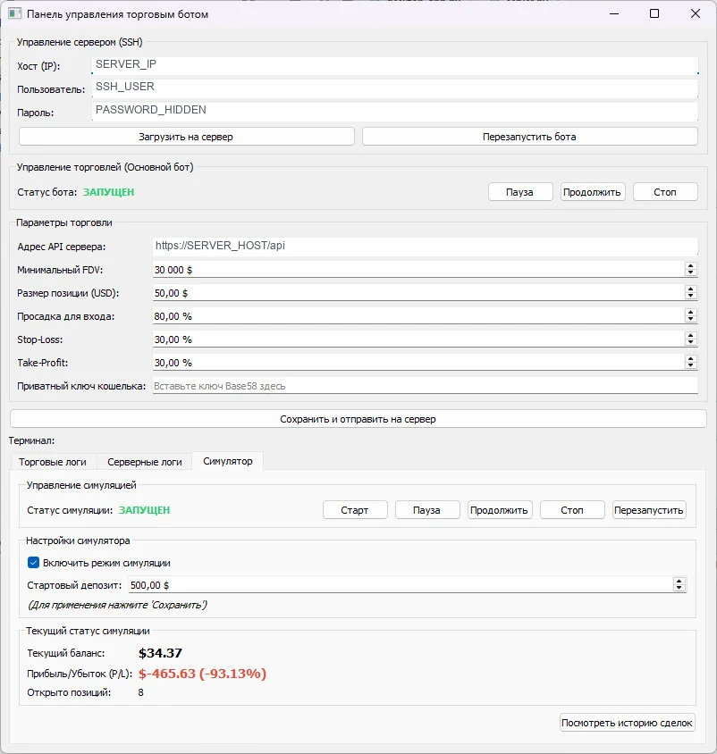

# PumpFun_TraderBot

Клиент-серверный прототип для наблюдения за токенами DexScreener и проверки правил входа после просадки цены. Сервер обрабатывает рыночные данные и состояние позиций, а приложение PyQt5 показывает статус, журнал и сделки, передавая команды через HTTP API.

**Python-портфолио Евгения Толмачева** · Python · Flask · PyQt5 · pyqtgraph · DexScreener API · Paramiko



## Возможности

- На сервере обнаруживает токены, проверяет кандидатов и обновляет общий кеш цен.
- Отслеживает просадку от максимума и условия выхода по Stop-Loss и Take-Profit.
- В режиме симуляции ведёт баланс и историю сделок, сохраняет состояние в JSON.
- В настольной панели позволяет менять настройки, приостанавливать обработку и просматривать журнал и сделки.
- Загружает свечи GeckoTerminal для графиков; содержит команды передачи серверного скрипта и перезапуска через SSH.

## Как устроен проект

### Сбор и обработка данных

[`server.py`](server.py)

DexScreenerMonitor обнаруживает токены, CandidateProcessor проверяет кандидатов, PriceManager обновляет кеш цен.

### Стратегия и состояние

[`server.py`](server.py)

TradingEngine отслеживает условие входа, PositionManager контролирует выход, TradingSimulator ведёт виртуальные сделки и баланс.

### HTTP API

[`server.py`](server.py)

Flask предоставляет маршруты статуса, настроек и управления. Общее состояние защищено блокировкой RLock.

### Настольная панель

[`desktop_app.py`](desktop_app.py)

TradingBotGUI отправляет команды серверу, TradesDialog показывает сделки, ChartDialog строит графики; Paramiko используется для SSH/SFTP.

## Технологии и их роль

- **Flask и Requests**: HTTP API между настольным клиентом и сервером.
- **Потоки, очереди и RLock**: Параллельный мониторинг и согласованный доступ к общему состоянию.
- **PyQt5 и pyqtgraph**: Панель управления, таблицы сделок и ценовые графики.
- **Paramiko**: SSH-команды и передача файлов через SFTP.
- **DexScreener и GeckoTerminal API**: Рыночные данные токенов и исторические свечи.

## С чего начать просмотр кода

server.py показывает разделение мониторинга, стратегии и HTTP API внутри серверного процесса. В desktop_app.py видны взаимодействие с API и устройство панели управления.

## Подготовка и запуск

Серверная часть проверена на **Python 3.12.14**, Windows. Для просмотра API без рыночных запросов и настольных зависимостей:

```powershell
py -3.12 -m venv .venv
.venv\Scripts\Activate.ps1
python -m pip install -r requirements-check.txt
python tools/run_demo.py
```

Откройте <http://127.0.0.1:5000/status>. Демонстрационный запуск использует существующее Flask-приложение, включает симулятор с виртуальным балансом 1000 и слушает только `127.0.0.1`. Рабочие потоки мониторинга не запускаются; состояние хранится во временной папке и удаляется при обычном завершении. Можно проверить команды:

```powershell
Invoke-RestMethod -Method Post http://127.0.0.1:5000/simulator/control/start
Invoke-RestMethod http://127.0.0.1:5000/status
Invoke-RestMethod -Method Post http://127.0.0.1:5000/simulator/control/pause
```

Для полной версии предусмотрены исходный `requirements.txt`, `python server.py` и `python desktop_app.py`. В клиенте укажите `http://127.0.0.1:5000` вместо `YOUR_SERVER_HOST`. Этот запуск обращается к внешним API. Исходный сервер слушает `0.0.0.0:5000` и не имеет авторизации API; его настройки требуют доработки перед публичным размещением. Полный GUI и SSH-развёртывание в этой проверке не запускались.

### Проверка

```powershell
python -m unittest discover -s tests -v
```

Пять проверок проходят: покупка/продажа и восстановление состояния, запрет покупки при паузе или недостатке средств, срок жизни цены в кеше, настройки и команды Flask API, отказ команд до включения симулятора. Все суммы и сделки виртуальные; внешние HTTP-запросы в тестах отключены. Дополнительно проверен реальный HTTP-запуск демо-сервера и его `/status`.

Методы реальных сделок `SolanaTrader` в этой версии являются заготовками и не отправляют транзакции.

## Структура

```text
PumpFun_TraderBot/
├── docs/
│   └── preview.webp
├── tests/
│   └── test_backend.py
├── tools/
│   └── run_demo.py
├── .gitignore
├── desktop_app.py
├── README.md
├── requirements-check.txt
├── requirements.txt
└── server.py
```

## Контекст и ограничения

Проект 2025 года показывает разделение серверного процесса и пользовательской панели. Реализованы мониторинг, API и учёт симулируемых сделок. Методы SolanaTrader вне режима симуляции пока возвращают локальный результат и не отправляют транзакции в блокчейн.

## Состав репозитория

Сохранены авторские исходники, их имена и структура, зависимости и компактный скриншот. Рабочие базы, наборы данных, модели и виртуальные окружения исключены. Секреты заменены обозначениями `YOUR_...` / `REDACTED_...`; реальные значения задаются локально. Исходные алгоритмы при оформлении портфолио не перерабатывались.

Автор: [Евгений Толмачев](https://github.com/EvgenyET) · [Портфолио](https://evgeny.tech/)
